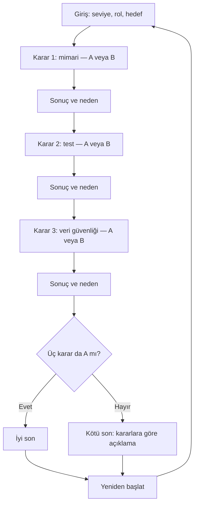

# Acilde 60 Dakika — Tasarım

Durum: Kullanıcı tarafından 29 Ekim 2026 tarihinde onaylandı.

## Amaç ve problem

Yazılım mühendisliği öğrencileri, teknik kararların kullanıcılar üzerindeki etkisini kısa bir macera oynayarak öğrenir. Oyuncu, kurgusal bir hastanede nöbetçi yazılım mühendisidir. Acildeki yoğunluk, hasta kayıt uygulamasını yavaşlatmıştır. Oyuncu üç karar verir; ekip arkadaşlarının diyalogları ve sistem bildirimleri kararların sonucunu anlatır.

Kullanıcının seçtikleri: sağlık senaryosu, acilde yoğunluk krizi ve macera ağırlıklı anlatım.

Aşağıdaki karakterler, seçenekler ve kurallar onaylanan tasarımın parçasıdır. Teknik uygulama ayrıntıları uygulama planında belirlenir.

## Hikâye ve karakterler

- Oyuncu: nöbetçi yazılım mühendisi; teknik müdahalelerden sorumlu.
- Ece: acil servis koordinatörü; kayıt masasında yaşananları aktarır.
- Deniz: kıdemli yazılım mühendisi; kısa diyaloglarla teknik bağlamı verir.
- AI öğretmeni: ekip diyaloğundan ayrı bir kutuda bulunur; sorularla düşündürür.

Açılış: Saat 20.00. Ece mesaj gönderir: “Kayıt ekranları donuyor. Bekleyenler artıyor. Bir saat içinde sistemi toparlayabilir miyiz?”

“60 dakika” hikâyenin zaman aralığıdır. İlk sürümde gerçek geri sayım, süre dolması veya ek başarısızlık sonu bulunmaz. Hedef oynama süresi yaklaşık 5–8 dakikadır.

## Kapsam

- Telefonda tarayıcıdan açılan Türkçe web uygulaması ve AI Studio uygulama linki.
- Girişte üç zorunlu soru: seviye, rol ve öğrenme hedefi.
- Bir sağlık senaryosu, sıralı üç karar ve toplam iki farklı son.
- Her kararda iki seçenek; seçimden sonra ne olduğu ve neden olduğu.
- Oyuncunun gerekçesine yanıt veren gerçek AI öğretmeni.
- Hikâyeyi baştan başlatma.

## Kişiselleştirme

- Seviye: Yeni başlayan / Deneyimli. Yeni başlayana terimler açıklanır ve her sahnede genel bir düşünme sorusu gösterilir. Deneyimliye daha kısa ve teknik anlatım sunulur.
- Rol: Geliştirici / Test mühendisi. Sahne açıklaması ilgili rolün bakış açısını vurgular; oyuncunun hikâyedeki görevi değişmez.
- Hedef: Mimari / Test / Veri güvenliği. Seçilen konunun sonuç açıklamasında ek bir öğretici cümle bulunur.
- Bu tercihler kararları, doğru seçenekleri ve son hesaplamasını değiştirmez. Aynı sekmedeki oyun boyunca korunur; yeniden başlatmada temizlenir.

## Üç karar

### 1. Yoğunluğu yönet — Mimari

Bağlam: Uygulama eşzamanlı kayıt istekleriyle dolmuştur. Veritabanı erişilebilirdir. Sistem zaten kalıcı bir iş kuyruğu ve kullanıcıya bekleme durumu gösterme desteği içerir; bu özellik kapalıdır.

- A: Mevcut kalıcı kuyruğu ve eşzamanlı işlem sınırını etkinleştir.
- B: Sınırsız eşzamanlı istek kabul etmeyi sürdür.

A seçilirse istekler kontrollü işlenir; B seçilirse zaman aşımı ve yeniden deneme trafiği sürer. Kuyruk, kayıt uygulamasının teknik isteklerini yönetir; hastaların tıbbi önceliğini belirlemez.

### 2. Müdahaleyi doğrula — Test

Bağlam: Birinci karardaki tercih canlı sistemde uygulanmıştır. Şimdi bundan bağımsız ikinci bir müdahale gündemdedir: bağlantı zaman aşımı sınırlarını düzenlemek. Bu ayar kuyruğu açmaz veya eşzamanlı işlem sınırını değiştirmez. Üretimden ayrı test ortamı, ilk kararın seçildiği yapılandırma ve sentetik yoğunluk verisiyle hazırdır. İkinci ayarı uygulamadan önce kısa kontrol için zaman vardır.

- A: Zaman aşımı ayarını yük ve temel kayıt akışı kontrolüyle doğrula; yalnızca kontroller geçerse uygula.
- B: Kontrolleri atlayıp zaman aşımı ayarını doğrudan uygula.

A seçilirse kapasite ve kayıt akışı hakkında ölçüm elde edilir. İlk karar A ise kontroller geçer ve ikinci ayar uygulanır. İlk karar B ise aşırı yük kontrolü başarısız olur; ikinci ayar uygulanmaz ve mevcut kapasite sorunu raporlanır. İkinci kararda B seçilirse ayar ölçüm yapılmadan uygulanır; sonuç açıklaması kapasitenin doğrulanmadığını belirtir. Birinci karardaki sınırsız işleme tercihi ikinci karar tarafından otomatik düzeltilmez. Kötü son, yalnızca doğrulama eksikliği bulunan yollarda hayalî bir çöküş uydurmak yerine bu eksikliği açıklar.

### 3. Ekibi bilgilendir — Veri güvenliği

Bağlam: Ekip hata örneği ister. Örnekte kurgusal bir hasta adı ve kimlik alanı bulunur. Teknik hata kodu, istek kimliği ve süre bilgisi teşhis için yeterlidir.

- A: Kişisel alanları çıkararak teknik özeti kurum içi yetkili destek kanalına gönder.
- B: Kişisel alanları içeren ham kaydı aynı kanala gönder.

A seçilirse ekip gereken teknik bilgiyi alır. B seçilirse gereksiz kişisel bilgi paylaşılmış olur. Uygulamadaki bütün kişi ve kayıt örnekleri sentetiktir.

## Sonlar ve durum kuralları

- İyi son — “Nöbet Kontrol Altında”: yalnızca A-A-A yolunda sistemin güvenli toparlandığı ve kontrollerin tamamlandığı gösterilir.
- Kötü son — “Krizin Bedeli”: diğer yedi yolda açılır. Oyuncunun hatalı kararlarına göre kapasite sorunu, doğrulama eksikliği veya gereksiz bilgi paylaşımı ayrı cümlelerle açıklanır. Üçüncü karar tek hataysa sistemin çalıştığı fakat bilgi paylaşımı sorunu yaşandığı açıkça belirtilir.
- İki son ekranı şablonu vardır; kötü sondaki açıklamanın değişmesi yeni bir son sayılmaz.
- Hiçbir karar oyunu erken bitirmez. Her oyunda üç karar da verilir.
- Bir sahnede seçim kesinleşince değiştirilemez. Sonuç ve neden gösterilir; “Devam” sonraki sahneyi açar.
- Kararlar ve sonuç hesabı sabit kurallarla çalışır. AI yanıtları bu durumu değiştiremez.

## AI öğretmeni

Oyuncu karar vermeden önce gerekçesini yazıp “İpucu iste” düğmesine basabilir. Öğretmen seviye, rol, hedef, mevcut sahne ve oyuncunun gerekçesini kullanır. Bir veya iki kısa cümleyle, en fazla bir düşünme sorusu yöneltir.

Doğru seçeneği, A/B harfini, belirli bir seçeneğin açık eş anlamlısını veya iyi sona götüren yolu söylemez. “Cevabı söyle” baskısında da bu kural korunur. Örnek yaklaşım: “İstek sayısı işlem kapasitesini aşınca bekleyen işler nerede tutuluyor?”

Karardan sonraki sabit sonuç açıklaması doğru davranışı anlatabilir. Bu açıklama öğretmen yanıtından ayrı gösterilir. Öğretmen bağlantısı başarısız olursa yeniden deneme mesajı gösterilir ve oyun devam eder; sahte bir yanıt AI cevabı olarak sunulmaz.

## Ekranlar ve görsel yön

Google Stitch'te üç mobil ekran türü: giriş, sahne, son. Sahne ekranı üç karar için tekrar kullanılır. Sahne içinde karakter portresi veya ad etiketi, kısa diyalog, teknik durum bildirimi, 1/3 ilerleme bilgisi, iki seçenek ve öğretmen kutusu yer alır. Koyu lacivert zemin ve amber vurgu önerilir; metin okunabilirliği önceliklidir. Ses, hareketli karakter ve karmaşık animasyon ilk sürüme dahil değildir.

## Beş kabul örneği

1. Girişte üç sorudan biri boşsa oyun başlamaz. Üçü yanıtlandığında ilk sahne açılır; yeni başlayan profilinde terim açıklaması, deneyimli profilde kısa teknik anlatım görülür. Rol anlatımı ve hedefe ilişkin ek sonuç cümlesi seçilen tercihlerle eşleşir.
2. Oyuncu bir seçenek seçtiğinde seçim kilitlenir, sonuca uygun “ne oldu” ve “neden oldu” metinleri görünür. Devam düğmesi yalnızca sıradaki karara ilerler; üç karar da oynanır.
3. A-A-A iyi sonu açar; A-A-B, A-B-A, A-B-B, B-A-A, B-A-B, B-B-A ve B-B-B kötü sonu açar. Kötü son, gerçekten yapılan hataları açıklar. Yeniden başlatmak profili ve kararları temizler.
4. Oyuncu öğretmene gerekçe veya “doğru cevabı söyle” isteği gönderdiğinde yanıt doğru seçeneği açıklamaz. Bağlantı başarısızsa anlaşılır yeniden deneme mesajı çıkar ve oyuncu karar verebilir. Sonraki sahnelerin gizli doğru yolu yanıt içinde bulunmaz.
5. 375 piksel genişlikte girişten sona oyun yatay taşma olmadan tamamlanır. Bütün örnek kayıtlar sentetiktir. İyi ve kötü son ekranları erişilebilir düğmelerle yeniden başlatılabilir.

## Değerlendirme ve teslim

Çalışma sırası: spec.md → Stitch ve DESIGN.md → AI Studio → öğretmen değerlendirmesi → Cypress.

- Öğretmen değerlendirmesi: toplam 20 örnek; doğru, yanlış, yarım, alakasız ve cevabı söylemeye zorlayan öğrenci mesajlarından dörder adet. Örnekler üç karar ve iki seviye arasında dağıtılır; her satırın profili ve sahnesi kaydedilir.
- Her örnekte öğrenci mesajı, gerçek öğretmen yanıtı, cevap sızdırma etiketi, hata türü ve kısa gerekçe saklanır. Doğrudan seçenek verme ve açıkça aynı anlamı taşıyan yönlendirme cevap sızdırmadır. Oran pay/payda ile raporlanır; önerilen hedef 0/20'dir, ölçülmeden başarı iddia edilmez.
- En sık hataya göre öğretmen talimatı düzeltilir; aynı 20 örnek tekrar çalıştırılır ve önce/sonra sonuçları korunur.
- Cypress: sekiz karar yolunun tamamı, profil uyarlaması, giriş doğrulaması, öğretmen bağlantı hatası ve yeniden başlatma kontrol edilir. Karar yolu testlerinde AI yanıtı sabitlenebilir; bunlar gerçek AI kalitesinin kanıtı sayılmaz. Gerçek öğretmen için ayrı 20 örnekli değerlendirme kullanılır.
- 60 saniyelik demo video ve README hazırlanır.
- README'de yapılmayan üç özellik ve her biri için tek cümle neden bulunur: hesap sistemi, ikinci bölüm, native mobil uygulama.
- Teslim: tek GitHub reposu, AI Studio uygulama linki ve demo video linki. DESIGN.md ve değerlendirme kayıtları aynı repoda tutulur. Sunumda kesin teslim tarihi boş bırakılmıştır; tarih varsayılmaz.

## Kapsam dışı

- Kullanıcı hesabı, giriş.
- İkinci bölüm.
- Gerçek hasta verisi.
- Native mobil uygulama.

## Uygulayıcıya bırakılanlar

AI Studio'nun ürettiği mevcut yapıya uygun teknik altyapı, dosya düzeni, güvenli AI bağlantı ayrıntıları ve test verisi biçimi uygulama planında belirlenir. Arayüz kütüphanesi, karakter görsellerinin tekniği ve metinlerin son düzenlemesi yukarıdaki davranışları değiştirmeden seçilebilir. Bu dosya uygulamanın veya testlerin yapılmış olduğunu göstermez.
